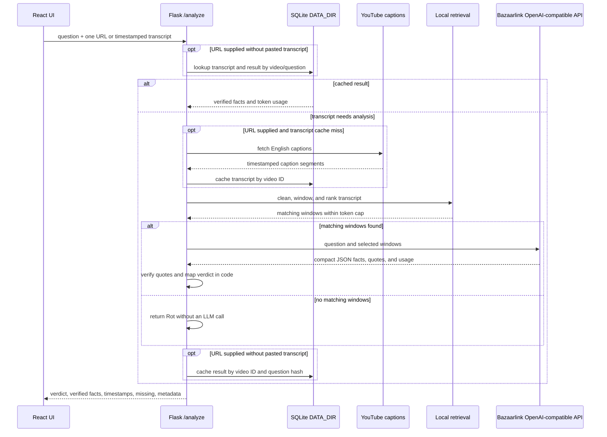

# Architecture

WorthRot uses a Flask API with a React/Vite frontend. Flask serves the built
frontend from `frontend/dist`; its catch-all serves `index.html` for client-side
routes while registered API routes retain priority. During local development,
Vite serves the UI and proxies API requests to Flask.

## Frontend structure

- `src/config/tabs.js` is the single list of navigation labels, routes, page
  elements, and availability.
- `src/main.jsx` composes `BrowserRouter`, `ThemeProvider`, `ToastProvider`,
  `HistoryProvider`, `AnalysisProvider`, `CompareProvider`, and the layout in
  that order.
- `src/layout/` contains the shared navigation and route outlet.
- `src/contexts/` separates analysis, theme, toast, history, and compare state.
  Each context provides a guarded custom hook and memoized actions/state.
- `src/components/ui/` contains reusable design-system primitives;
  `src/components/youtube/` contains analyzer form and result components.
- `src/styles/` holds theme tokens, base styles, and component styles.
- `/compare` ranks two or three YouTube videos for one question. About remains
  a placeholder. The History page displays locally saved analysis results.
- `src/lib/historyStorage.js` validates and persists result summaries in
  browser `localStorage`; analysis still works when storage is unavailable.

## YouTube analysis pipeline

`POST /analyze` accepts one YouTube URL, a question, and optionally a pasted
timestamped transcript. A pasted transcript takes precedence over caption
retrieval. The pipeline cleans caption text, merges it into timestamped
30–45-second windows, ranks windows locally with plain-Python BM25, and sends
only the top matching context to the configured model provider. Transcripts under
`SHORT_TRANSCRIPT_TOKENS` skip keyword retrieval, subject to the context cap.
The cap includes the question and formatted transcript windows.

The model returns compact JSON facts and internal source quotes. The verifier
requires each quote to match its exact timestamped window after case and
whitespace normalization. Only verified facts reach the response. Code maps
coverage and verified-fact count to the verdict; no fact is inferred from a
video title. A long transcript with no matching windows returns `Rot` without
an LLM call.

After a successful analysis with a `Worth it`, `Skim`, or `Rot` verdict, the
frontend saves the question and result summary to `localStorage` on that
browser. It does not store transcripts, internal quotes, or token metadata.
Each successful Compare row with one of those verdicts is saved as an
individual History entry using the same storage and deduplication rules.
Failed or `Can't verify` rows are not saved.
History reads, expands, and deletes these local entries without requesting
`/analyze`; entries are limited to 50 and deduplicated by video and normalized
question. The server-side SQLite cache remains separate and is not an account
or ownership system. No cookies are set.

Transcript and question-specific result caches use SQLite under `DATA_DIR`.
Local runs default to `src/backend/data`; deployments must provide their
persistent `DATA_DIR` path. Transcript duration is measured from available
caption timestamps because the application does not fetch or scrape video
metadata. YouTube may block caption requests from cloud-hosted IPs; the API
returns an actionable error asking for a pasted timestamped transcript.

## Multi-video comparison

`POST /compare` validates a non-empty question, two to
`MAX_COMPARE_VIDEOS` (default 3) distinct YouTube video IDs, then runs the same
single-video analysis service concurrently. Each worker opens its own SQLite
connections; SQLite uses a busy timeout, and the LLM uses independent standard
library HTTP requests. Each video has a `COMPARE_TIMEOUT_SECONDS` (default 45)
deadline. Timeouts and per-video failures become `Can't verify` rows instead of
failing the request.

The pure-code ranker orders by verdict (`Worth it`, `Skim`, `Rot`, `Can't
verify`), then coverage, verified fact count, and stable input order. Internal
coverage and fact-count fields never appear in the API response. `best` is
non-null only when the leading result is `Worth it` or `Skim`. Cached analysis
results are reused per video and question, so repeat comparisons make no model
calls for cached videos.



```mermaid
sequenceDiagram
    participant UI as Compare UI
    participant API as Flask /compare
    participant Workers as Parallel pipeline workers
    participant Cache as SQLite DATA_DIR
    participant YT as YouTube captions
    participant LLM as Bazaarlink API
    participant Rank as Local ranker
    UI->>API: question + 2-3 YouTube URLs
    API->>API: validate URLs and unique video IDs
    par One analysis per video, with timeout
        API->>Workers: analyze_video(question, URL)
        Workers->>Cache: lookup transcript/result
        opt transcript cache miss
            Workers->>YT: fetch captions
            YT-->>Workers: timestamped caption segments
            Workers->>Cache: save transcript
        end
        opt result cache miss and matching evidence exists
            Workers->>LLM: question + selected transcript windows
            LLM-->>Workers: candidate facts and token usage
        end
        Workers->>Workers: verify facts and map verdict
        Workers->>Cache: save result
        Workers-->>API: public facts + internal rank fields
    and
        API->>Workers: analyze remaining videos concurrently
    end
    API->>Rank: rank results; preserve stable ties
    Rank-->>API: distinct ranks and best video ID or null
    API-->>UI: per-video facts, errors, ranks, aggregate tokens
```

## API contract

- `GET /health` returns `{"status": "ok"}`.
- `POST /analyze` accepts:

  ```json
  { "question": "string", "urls": ["string"], "transcript": "string (optional)" }
  ```

- Success returns one analyzed video:

  ```json
  {
    "verdict": "Worth it | Skim | Rot | Can't verify",
    "facts": [{ "text": "string", "timestamp": "mm:ss", "url": "string" }],
    "missing": ["string"],
    "meta": {
      "video_id": "string",
      "cached": false,
      "tokens_in": 0,
      "tokens_out": 0
    }
  }
  ```

  Each fact URL is the YouTube URL with its timestamp parameter; it is empty
  for transcript-only input. Internal verification quotes are never returned.
  Errors use a JSON object with a human-readable `message`; caption or LLM
  failures also include a `result` with a `Can't verify` verdict.

- `POST /compare` accepts:

  ```json
  { "question": "string", "urls": ["string", "string"] }
  ```

- Success returns:

  ```json
  {
    "question": "string",
    "best": "video_id or null",
    "ranking": [
      {
        "rank": 1,
        "videoId": "string",
        "url": "string",
        "verdict": "Worth it | Skim | Rot | Can't verify",
        "facts": [{ "text": "string", "timestamp": "mm:ss", "url": "string" }],
        "missing": ["string"],
        "error": null,
        "meta": { "cached": false, "tokens_in": 0, "tokens_out": 0 }
      }
    ],
    "meta": { "tokens_in_total": 0, "tokens_out_total": 0 }
  }
  ```

  Each failed video has verdict `Can't verify` and an `error` object containing
  a human-readable `message`; other video results remain available. `best` is
  set only for a leading `Worth it` or `Skim` result. Coverage and verified
  fact counts are private ranker inputs.

## Configuration

See `.env.example` for `BAZAARLINK_API_KEY`, `LLM_BASE_URL`, `MODEL_NAME`,
token/window limits, `MAX_VIDEO_MINUTES`, `MAX_COMPARE_VIDEOS`,
`COMPARE_TIMEOUT_SECONDS`, and `DATA_DIR`. For local
development, the root `.env` file is loaded automatically and ignored by Git.
Hosted deployments should configure the key, base URL, and model as
environment variables. The default model is `qwen/qwen3.7-flash:free` and the
default base URL is `https://api.bazaarlink.ai/v1`. The output token setting
cannot exceed 300. The OpenAI-compatible Chat Completions API is called with
the Python standard library.

## Browser history

The `HistoryProvider` is nested inside `ToastProvider` and before
`AnalysisProvider`. Successful single-video analyses call its `addEntry` action
once; successful Compare rows call the same action once per checked video.
`HistoryPage` reads from this context, and expanded entries use the same
`FactsPanel` as fresh analysis results. The storage module validates every
loaded entry and catches blocked-storage, malformed-data, and quota errors.
History is per browser and device; clearing site data removes it.

## Current boundaries

- Compare ranks at most three YouTube videos; it does not accept pasted
  transcripts or save failed/`Can't verify` results to History.
- Only YouTube videos are supported; no other video platforms are in scope.
- No media is downloaded and no transcript is persisted outside `DATA_DIR`.
- Real caption retrieval may fail in hosted environments due to YouTube IP
  blocking; paste a timestamped transcript as the fallback.
