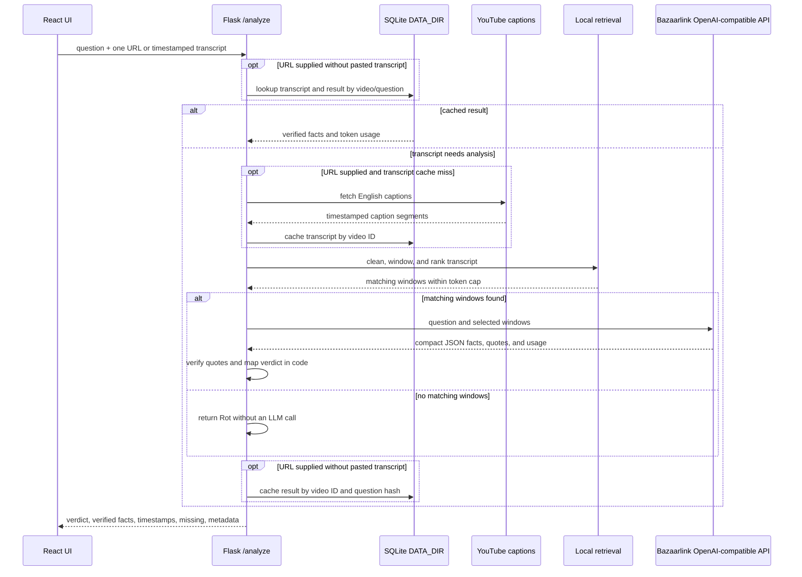

# Architecture

WorthRot uses a Flask API with a React/Vite frontend. Flask serves the built
frontend from `frontend/dist`; its catch-all serves `index.html` for client-side
routes while registered API routes retain priority. During local development,
Vite serves the UI and proxies API requests to Flask.

## Frontend structure

- `src/config/tabs.js` is the single list of navigation labels, routes, page
  elements, and availability.
- `src/main.jsx` composes `BrowserRouter`, `ThemeProvider`, `ToastProvider`,
  `HistoryProvider`, `AnalysisProvider`, `CompareProvider`, `OtherProvider`,
  and the layout in that order.
- `src/layout/` contains the shared navigation and route outlet.
- `src/contexts/` separates analysis, theme, toast, history, compare, and media
  upload state.
  Each context provides a guarded custom hook and memoized actions/state.
- `src/components/ui/` contains reusable design-system primitives;
  `src/components/youtube/` contains analyzer form and result components.
- `/about` is a static page composed from `src/config/about.js`; it uses no
  context, API calls, or storage.
- `src/styles/` holds theme tokens, base styles, and component styles.
- `/compare` ranks two or three YouTube videos for one question. `/other`
  analyzes user-uploaded MP4/MP3 files. Successful single-video and media
  analyses are saved to History as result summaries; Compare is not.
- `src/lib/historyStorage.js` validates and persists result summaries in
  browser `localStorage`; analysis still works when storage is unavailable.

## YouTube analysis pipeline

`POST /analyze` accepts one YouTube URL, a question, and optionally a pasted
timestamped transcript. A pasted transcript takes precedence over caption
retrieval. The pipeline cleans caption text, merges it into timestamped
30–45-second windows, ranks windows locally with plain-Python BM25, and sends
only the top matching context to the configured model provider. Transcripts under
`SHORT_TRANSCRIPT_TOKENS` skip keyword retrieval, subject to the context cap.
The cap includes the question and formatted transcript windows.

The model returns compact JSON facts and internal source quotes. The verifier
requires each quote to match its exact timestamped window after case and
whitespace normalization. Only verified facts reach the response. Code maps
coverage and verified-fact count to the verdict; no fact is inferred from a
video title. A long transcript with no matching windows returns `Rot` without
an LLM call.

After a completed `/analyze` or `/analyze-media` request, the frontend saves
the question and result summary to `localStorage` on that browser. Media
entries are labelled "Other upload" and retain no uploaded file or transcript.
History omits transcripts, internal quotes, and token metadata. Compare
results are not saved. History reads, expands, and deletes these local entries
without requesting an analysis; entries are limited to 50 and YouTube
analyses are deduplicated by video and normalized question. The server-side
SQLite cache remains separate and is not an account or ownership system. No
cookies are set.

Transcript and question-specific result caches use SQLite under `DATA_DIR`.
Local runs default to `src/backend/data`; deployments must provide their
persistent `DATA_DIR` path. Transcript duration is measured from available
caption timestamps because the application does not fetch or scrape video
metadata. YouTube may block caption requests from cloud-hosted IPs; the API
returns an actionable error asking for a pasted timestamped transcript.

## Multi-video comparison

`POST /compare` validates a non-empty question, two to
`MAX_COMPARE_VIDEOS` (default 3) distinct YouTube video IDs, then runs the same
single-video analysis service concurrently. Each worker opens its own SQLite
connections; SQLite uses a busy timeout, and the LLM uses independent standard
library HTTP requests. Each video has a `COMPARE_TIMEOUT_SECONDS` (default 45)
deadline. Timeouts and per-video failures become `Can't verify` rows instead of
failing the request.

The pure-code ranker orders by verdict (`Worth it`, `Skim`, `Rot`, `Can't
verify`), then coverage, verified fact count, and stable input order. Internal
coverage and fact-count fields never appear in the API response. `best` is
non-null only when the leading result is `Worth it` or `Skim`. Cached analysis
results are reused per video and question, so repeat comparisons make no model
calls for cached videos.



```mermaid
sequenceDiagram
    participant UI as Compare UI
    participant API as Flask /compare
    participant Workers as Parallel pipeline workers
    participant Cache as SQLite DATA_DIR
    participant YT as YouTube captions
    participant LLM as Bazaarlink API
    participant Rank as Local ranker
    UI->>API: question + 2-3 YouTube URLs
    API->>API: validate URLs and unique video IDs
    par One analysis per video, with timeout
        API->>Workers: analyze_video(question, URL)
        Workers->>Cache: lookup transcript/result
        opt transcript cache miss
            Workers->>YT: fetch captions
            YT-->>Workers: timestamped caption segments
            Workers->>Cache: save transcript
        end
        opt result cache miss and matching evidence exists
            Workers->>LLM: question + selected transcript windows
            LLM-->>Workers: candidate facts and token usage
        end
        Workers->>Workers: verify facts and map verdict
        Workers->>Cache: save result
        Workers-->>API: public facts + internal rank fields
    and
        API->>Workers: analyze remaining videos concurrently
    end
    API->>Rank: rank results; preserve stable ties
    Rank-->>API: distinct ranks and best video ID or null
    API-->>UI: per-video facts, errors, ranks, aggregate tokens
```

## API contract

- `GET /health` returns `{"status": "ok"}`.

- `GET /limits` returns current availability without consuming quota:

  ```json
  {
    "limits": {
      "analyze": { "limit": 10, "remaining": 10, "resetsAt": "ISO 8601" },
      "compare": { "limit": 10, "remaining": 10, "resetsAt": "ISO 8601" },
      "media": { "limit": 10, "remaining": 10, "resetsAt": "ISO 8601" }
    }
  }
  ```

- Limited responses include `X-RateLimit-Limit`,
  `X-RateLimit-Remaining`, and `X-RateLimit-Reset` headers. A daily denial is
  `429` with `message`, `code` (`rate_limited` or `capacity_reached`),
  `retry_after_seconds`, and `resets_at`, plus the `Retry-After` header.
- `POST /analyze` accepts:

  ```json
  { "question": "string", "urls": ["string"], "transcript": "string (optional)" }
  ```

- Success returns one analyzed video:

  ```json
  {
    "verdict": "Worth it | Skim | Rot | Can't verify",
    "facts": [{ "text": "string", "timestamp": "mm:ss", "url": "string" }],
    "missing": ["string"],
    "meta": {
      "video_id": "string",
      "cached": false,
      "tokens_in": 0,
      "tokens_out": 0
    }
  }
  ```

  Each fact URL is the YouTube URL with its timestamp parameter; it is empty
  for transcript-only input. Internal verification quotes are never returned.
  Errors use a JSON object with a human-readable `message`; caption or LLM
  failures also include a `result` with a `Can't verify` verdict.

- `POST /compare` accepts:

  ```json
  { "question": "string", "urls": ["string", "string"] }
  ```

- Success returns:

  ```json
  {
    "question": "string",
    "best": "video_id or null",
    "ranking": [
      {
        "rank": 1,
        "videoId": "string",
        "url": "string",
        "verdict": "Worth it | Skim | Rot | Can't verify",
        "facts": [{ "text": "string", "timestamp": "mm:ss", "url": "string" }],
        "missing": ["string"],
        "error": null,
        "meta": { "cached": false, "tokens_in": 0, "tokens_out": 0 }
      }
    ],
    "meta": { "tokens_in_total": 0, "tokens_out_total": 0 }
  }
  ```

  Each failed video has verdict `Can't verify` and an `error` object containing
  a human-readable `message`; other video results remain available. `best` is
  set only for a leading `Worth it` or `Skim` result. Coverage and verified
  fact counts are private ranker inputs.

- `POST /analyze-media` accepts multipart form data with a `question` and one
  MP4/MP3 `file`. Content bytes, size, duration, and streams are validated
  before analysis. Uploaded media is written under
  `DATA_DIR/tmp/<uuid>/` and deleted after the request.

  ```json
  {
    "verdict": "Worth it | Skim | Rot | Can't verify",
    "source": "subtitles | speech | frames",
    "facts": [{ "text": "string", "timestamp": "mm:ss or null", "url": null }],
    "missing": ["string"],
    "meta": { "tokens_in": 0, "tokens_out": 0, "frames_sent": 0 }
  }
  ```

  MP4 processing prefers embedded subtitles, then Gemini speech-to-text when
  `GEMINI_API_KEY` is configured, then sampled, deduplicated frames. Gemini
  HTTP 429 responses trigger an ElevenLabs STT request when `ELEVEN_LABS_API`
  is configured. MP3 uses the same speech transcription path. Transcription
  requests include segment or word timestamps; missing or out-of-range
  timestamps are discarded, and untimed speech returns `Can't verify`. Frame
  facts must cite a sampled timestamp and the verdict is capped at `Skim`. The
  frame path sends one vision request with no more than `MAX_FRAMES` images.

## Configuration

See `.env.example` for provider, token/window, compare, media, upload, frame,
ffmpeg, Gemini/ElevenLabs STT, rate-limit, and `DATA_DIR` settings. For local
development, the root `.env` file is loaded automatically and ignored by Git.
Hosted deployments should configure the key, base URL, and model as
environment variables. Media frame analysis reuses the same `MODEL_NAME` and
`LLM_BASE_URL` as transcript analysis; the standard Bazaarlink URL is used by
default, so provider setup requires only `BAZAARLINK_API_KEY`. The output token setting
cannot exceed 300. The OpenAI-compatible Chat Completions API is called with
the Python standard library. Media transcription sends audio directly to the
Gemini `generateContent` API using `GEMINI_API_KEY`; only Gemini HTTP 429
responses trigger a fallback to ElevenLabs' speech-to-text API using
`ELEVEN_LABS_API`.

## Daily request limits

`POST /analyze`, `/compare`, and `/analyze-media` each have an independent
daily limit per client network. The default is 10 successful requests per
feature and a global cap of 200 per feature. Reservations happen before route
logic can parse a body or invoke an LLM or ffmpeg; non-2xx responses and
exceptions release the reserved per-client and global slots. Cache hits and
successful `Can't verify` responses count. A Compare request counts once even
when it runs up to three video analyses.

`backend/rate_limit.py` resolves the configured trusted forwarding hop,
groups IPv6 addresses by `/64`, and stores only salted HMAC hashes and counts
in a separate SQLite database under `DATA_DIR`. A conditional transactional
update prevents concurrent requests from taking the last slot twice. Storage
errors fail closed with 503. Old count rows are purged at startup and every
100th limited request. `GET /limits` supplies the three per-network counters;
limited responses also carry the `X-RateLimit-*` headers and provide reset
details in 429 JSON responses.

The frontend `RateLimitProvider` is nested after `HistoryProvider` and before
the analysis, comparison, and media contexts. Each feature context updates
only its own quota state from response headers. A shared `RateLimitNotice`
shows availability and disables its form submit button when the server reports
zero remaining.

The About page discloses that salted IP hashes are retained for up to two
days. The actual Embarko forwarding-header chain and hop count, persistence of
`DATA_DIR` across restarts/redeploys, and provider-side spend limits are not
verified; see `docs/adr/ADR-010-ip-rate-limiting.md`.

## Browser history

The `HistoryProvider` is nested inside `ToastProvider` and before
`AnalysisProvider`. Completed single-video and media analyses call its
`addEntry` action; Compare results do not write to History.
`HistoryPage` reads from this context, and expanded entries use the same
`FactsPanel` as fresh analysis results. The storage module validates every
loaded entry and catches blocked-storage, malformed-data, and quota errors.
History is per browser and device; clearing site data removes it.

## Current boundaries

- Compare ranks at most three YouTube videos; it does not accept pasted
  transcripts or save results to History.
- Other analyzes user-provided MP4/MP3 files only; it does not accept external
  media URLs. Only result summaries, never files or transcripts, are saved to
  History. One media job runs at a time, and request workdirs are swept when
  older than one hour.
- No media is downloaded or persisted after a request. No transcript is
  persisted outside the existing `DATA_DIR` cache for YouTube analysis.
- Real caption retrieval may fail in hosted environments due to YouTube IP
  blocking; paste a timestamped transcript as the fallback.
- Embarko ffmpeg availability, its proxy request timeout, BazaarLink STT
  support, and the configured vision model's image limits remain unverified.
