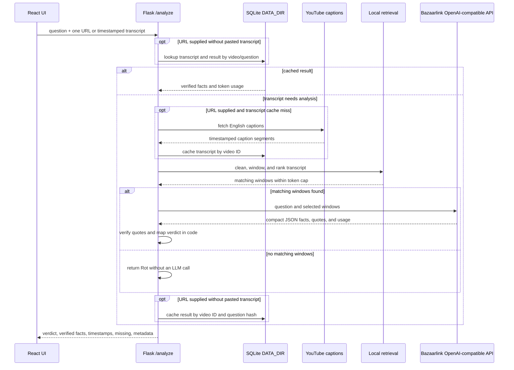

# Architecture

WorthRot uses a Flask API with a React/Vite frontend. Flask serves the built
frontend from `frontend/dist`; its catch-all serves `index.html` for client-side
routes while registered API routes retain priority. During local development,
Vite serves the UI and proxies API requests to Flask.

## Frontend structure

- `src/config/tabs.js` is the single list of navigation labels, routes, page
  elements, and availability.
- `src/main.jsx` composes `BrowserRouter`, `ThemeProvider`, `ToastProvider`,
  `AnalysisProvider`, and the layout in that order.
- `src/layout/` contains the shared navigation and route outlet.
- `src/contexts/` separates analysis, theme, and toast state. Each context
  provides a guarded custom hook and memoized actions/state.
- `src/components/ui/` contains reusable design-system primitives;
  `src/components/youtube/` contains analyzer form and result components.
- `src/styles/` holds theme tokens, base styles, and component styles.
- `/compare`, `/instagram`, `/history`, and `/about` are navigation-ready
  placeholders. The YouTube analyzer is the only functional page.

## YouTube analysis pipeline

`POST /analyze` accepts one YouTube URL, a question, and optionally a pasted
timestamped transcript. A pasted transcript takes precedence over caption
retrieval. The pipeline cleans caption text, merges it into timestamped
30–45-second windows, ranks windows locally with plain-Python BM25, and sends
only the top matching context to the configured model provider. Transcripts under
`SHORT_TRANSCRIPT_TOKENS` skip keyword retrieval, subject to the context cap.
The cap includes the question and formatted transcript windows.

The model returns compact JSON facts and internal source quotes. The verifier
requires each quote to match its exact timestamped window after case and
whitespace normalization. Only verified facts reach the response. Code maps
coverage and verified-fact count to the verdict; no fact is inferred from a
video title. A long transcript with no matching windows returns `Rot` without
an LLM call.

Transcript and question-specific result caches use SQLite under `DATA_DIR`.
Local runs default to `src/backend/data`; deployments must provide their
persistent `DATA_DIR` path. Transcript duration is measured from available
caption timestamps because the application does not fetch or scrape video
metadata. YouTube may block caption requests from cloud-hosted IPs; the API
returns an actionable error asking for a pasted timestamped transcript.



## API contract

- `GET /health` returns `{"status": "ok"}`.
- `POST /analyze` accepts:

  ```json
  { "question": "string", "urls": ["string"], "transcript": "string (optional)" }
  ```

- Success returns one analyzed video:

  ```json
  {
    "verdict": "Worth it | Skim | Rot | Can't verify",
    "facts": [{ "text": "string", "timestamp": "mm:ss", "url": "string" }],
    "missing": ["string"],
    "meta": {
      "video_id": "string",
      "cached": false,
      "tokens_in": 0,
      "tokens_out": 0
    }
  }
  ```

  Each fact URL is the YouTube URL with its timestamp parameter; it is empty
  for transcript-only input. Internal verification quotes are never returned.
  Errors use a JSON object with a human-readable `message`; caption or LLM
  failures also include a `result` with a `Can't verify` verdict.

## Configuration

See `.env.example` for `BAZAARLINK_API_KEY`, `LLM_BASE_URL`, `MODEL_NAME`,
token/window limits, `MAX_VIDEO_MINUTES`, and `DATA_DIR`. For local
development, the root `.env` file is loaded automatically and ignored by Git.
Hosted deployments should configure the key, base URL, and model as
environment variables. The default model is `qwen/qwen3.7-flash:free` and the
default base URL is `https://api.bazaarlink.ai/v1`. The output token setting
cannot exceed 300. The OpenAI-compatible Chat Completions API is called with
the Python standard library.

## Current boundaries

- Only one video is analyzed per request; multi-video ranking is not
  implemented.
- Instagram remains paste-transcript-only and is not part of this pipeline.
- No media is downloaded and no transcript is persisted outside `DATA_DIR`.
- Real caption retrieval may fail in hosted environments due to YouTube IP
  blocking; paste a timestamped transcript as the fallback.
